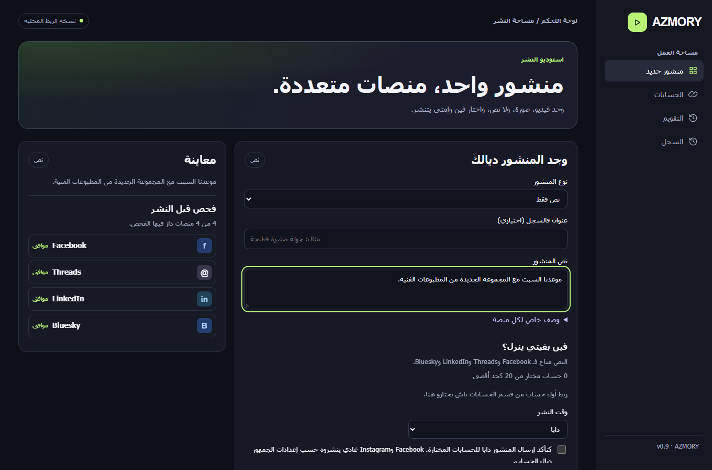

# Azmory

**A local-first publishing desk for creators working in Moroccan Arabic.** Prepare a video, image or text post once, adapt its caption for each destination and track the result separately for every account.



## Try it without an account

Install Node.js 24 or later. From the extracted project folder run:

```sh
npm start
```

Open **http://127.0.0.1:8787**. Windows users can also launch `START-WINDOWS.cmd`. The app and its tests run with Node's built-in modules. No package installation is required.

In the composer, switch from video to photo to text. Enter a caption, select scheduled publishing to reveal the date field, then return to immediate publishing. You can explore the interface before connecting an account.

## Publishing paths implemented in 0.9

| Destination | Video | Photo | Text | Provider |
| --- | --- | --- | --- | --- |
| Facebook Page | Yes | Yes | Yes | Meta |
| Instagram professional account | Yes | JPEG | — | Meta, with Cloudinary staging for photos |
| YouTube channel | Yes | — | — | Google OAuth and YouTube Data API |
| TikTok | Yes | — | — | Buffer |
| Threads, LinkedIn, Bluesky | Yes | Yes | Yes | Buffer |

For live use, configure the credentials in a local copy of `.env.example` named `.env`. Buffer media posts use Cloudinary staging. Provider access depends on the connected account and permissions. The Arabic guide includes account-specific setup, media requirements and authorisation steps.

## Scheduling and recovery

The local Node process must stay running for the scheduler to dispatch posts. A job tracks the outcome for each destination. If a remote upload may already have succeeded, check the provider before retrying. The app stores local state, connection details and staged files in `.reeldesk-data/`. Keep that folder and `.env` private.

## Structure

| File | Responsibility |
| --- | --- |
| `public/index.html` | RTL composer, accounts, calendar and publishing history |
| `public/preflight.cjs` | Shared media and caption validation |
| `server.mjs` | Local HTTP routes, OAuth callbacks, job lifecycle and persistence |
| `providers.mjs` | Direct Meta and YouTube integration |
| `buffer-publisher.mjs` | Buffer channel discovery, staging and status handling |
| `test/` | Local integration tests and mocked provider responses |

## Validation

Run `npm test`. All 19 tests passed on Windows with Node 26.13.0 after correcting the Windows module URL in the integration test. Coverage includes caption and media checks, per-destination failures, cancellation, restart recovery and uncertain provider outcomes. A local Chrome walkthrough exercised the three composer modes, captions and scheduling controls. Live OAuth and publishing against creator accounts remain unverified in this review.

## Project documentation

- [Arabic setup and operating guide](docs/GUIDE.ar.md)
- [Roadmap and acceptance criteria](ROADMAP.md)
- [Étude de cas (PDF)](docs/etude-de-cas.pdf)
- [Charte graphique (PDF)](docs/charte-graphique.pdf)
